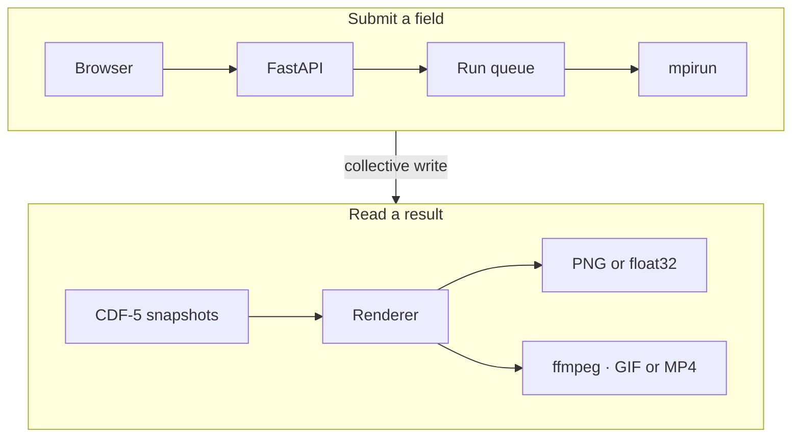
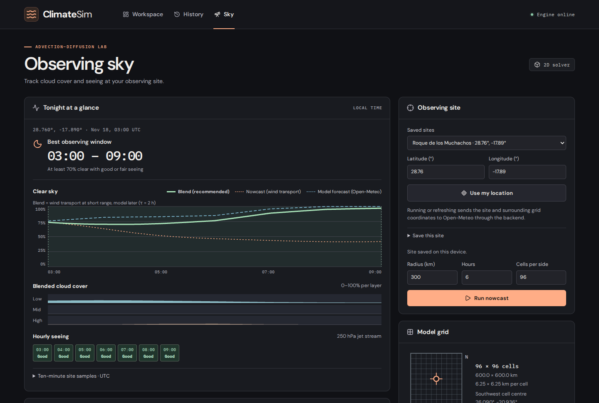
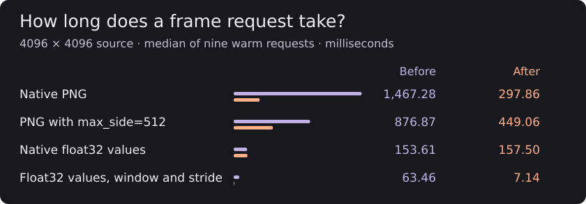

# 

**Submit a field once, watch its frames arrive over HTTP, and take the whole run home as NetCDF.**

[](https://github.com/antoniorizzoeng/climate-sim-backend/actions/workflows/ci.yml)
[](https://github.com/antoniorizzoeng/climate-sim-backend/actions/workflows/codeql.yml)
[](LICENSE)
[](api/openapi.yaml)

<p align="center">
  
  <br/>
  <em>Maximum along z · 512 × 156 × 20 cells · two MPI ranks · plasma</em>
</p>

## Why

A browser can ask for a single pixel while the solver is still writing the next frame. This single-user FastAPI service owns the queue, snapshot files and encoders so every client can work with the same run ID.

| Start a run | Read a run |
| --- | --- |
| **Inputs** · Upload NetCDF, send a drawn float32 plane, or start from a preset. Select a variable, an indexed plane or a full volume. | **Frames** · Request a PNG, float32 window or 3D volume. Choose an axis for slices and maximum or mean projections. |
| **Queue** · Validate grid, stability, ranks and free space. One local worker launches MPI jobs in submission order. | **Exports** · Download the original CDF-5 output, or encode an MP4 or GIF with the chosen range, view, colormap and frame rate. |

## Quick start

From this checkout, start the API and its MPI engine with Docker Compose. The first build needs network access. Port 8000 must be free.

```sh
docker compose up --build
```

With the service running, submit a drifting hotspot from a second terminal.

```sh
curl -fsS http://localhost:8000/runs -H 'Content-Type: application/json' -d '{
  "source":{"kind":"preset","preset":"gaussian_hotspot","nx":64,"ny":32},
  "processes":2,"dt":0.2,"D":0.1,"vx":1,"steps":60,"frames":7
}'
```

Copy the returned `id` into **GET /runs/{runId}** in the interactive docs. When `frames` reaches 7, request frame 6 for the final image. Compose stores the data in the `simulations` volume. [Interactive API on localhost](http://localhost:8000/docs) · [Versioned OpenAPI contract](api/openapi.yaml)

## How a request reaches the solver



One API process holds the data-directory lock. It serves completed frames while a simulation or export continues. On restart, queued jobs resume and interrupted simulations receive an error status. The queue length, active run ID and free space are available in health-response headers.

## Sky nowcast



At **Roque de los Muchachos**, the curves begin together and then diverge as the wind carries clouds across the site. The screenshot is a saved six-hour forecast. Its highlighted observing window belongs to that forecast time.

1. **Transport.** Open-Meteo supplies low, mid and high cloud cover and winds at 850, 500 and 300 hPa. Three MPI runs transport the layers across a local grid with zero-gradient edges. The default grid is 96² over 600 km. Frames are ten minutes apart.
2. **Blend.** The site timeline combines transported cover with the hourly model forecast. The transport weight is `exp(−t/τ)` for lead time `t`. With the default `τ = 2 h`, transport supplies about 37% after two hours. Layer overlap is treated as random when computing the transported total.
3. **Observing window.** The longest stretch with at least 70% blended clear sky and good or fair seeing wins. The earliest stretch wins a tie. Seeing comes from 250 hPa wind speed alone, and local turbulence can dominate.

The solver omits cloud formation, dissipation and vertical motion. Incoming cloud beyond the finite grid is unknown. The only location data in the weather request are the site and surrounding grid coordinates. Open-Meteo also receives the requested variables and UTC hours. Site names, uploaded fields and simulation results stay local. [Open-Meteo forecast variables](https://open-meteo.com/en/docs) · [Saved-forecast evaluation against later model estimates](scripts/nowcast_skill.py)

## Performance

A native 4096² PNG fell from **1,467 to 298 ms** in the rendering benchmark. Reading a strided window of values fell from **63.46 to 7.14 ms**. Fetching an entire float32 plane still transfers 64 MiB and took slightly longer after the change.



Nine warm requests per case, one logical CPU on a Ryzen 5 8500G, in-process FastAPI client. Network latency, MPI stepping and movie encoding are outside these timings. [Benchmark data and setup](docs/performance.md) · [Chart generator](scripts/readme_chart.py)

## API reference

| Request | Result |
| --- | --- |
| `POST /fields` · `POST /fields/drawn` | Stored field ID and metadata for an upload or a bottom-row-first drawing. |
| `POST /runs/validate` · `POST /runs` | Resolved settings and warnings, or a queued run. Poll `GET /runs/{runId}` for readable frames. |
| `GET /runs/{runId}/frames/{n}.png` | Zero-based frame. Set `colormap`, `vmin` and `vmax`, and optionally `max_side`. |
| `GET /runs/{runId}/frames/{n}/values` · `…/volume` | Little-endian float32 plane or volume. Window and stride the plane, or read a 3D grid. |
| `GET /runs/{runId}/result.nc` · `…/export.gif` · `…/export.mp4` | Completed data or animation. On HTTP 202, poll the export after `Retry-After`. |
| `POST /nowcasts` · `GET /nowcasts/{id}` | Submit site coordinates, then read the site timeline, best window and three layer run IDs. |

**Retention.** Fields stay active for seven days after last use, then archived originals remain available for another 30 days. Running an archived field reactivates it. Completed run outputs expire after seven days. A run can be repeated until day 37 if its source remains available. Completed nowcasts expire after seven days.

<details>
<summary><strong>Deployment settings and engine compatibility</strong></summary>

| Environment | Local default | Purpose |
| --- | --- | --- |
| `DATA_DIR` | `./data` | Persistent state. Give each API process its own directory. |
| `ENGINE_BIN` | `climate_sim` on PATH | Native executable used by the worker and capability probes. |
| `MPIRUN` · `MPIRUN_ARGS` | `mpirun` · empty | Launcher and extra arguments. Compose enables oversubscription. |
| `CORS_ORIGINS` | `http://localhost:3000` | Comma-separated list of permitted browser origins. |
| `DISK_SAFETY_MARGIN_BYTES` | `2147483648` | Free space reserved on the data filesystem. |
| `ENGINE_PERIODIC` | `1` | Advertise wrapping when the engine passes its periodic-boundary probe. |

The Docker build fetches engine `main`. If Sky reports that the engine ignores `wind.mode=file`, a cached build layer may contain an older executable. Set the Docker build argument `ENGINE_REF` to the current engine commit and rebuild the API image. The engine health response includes a binary fingerprint.

[Environment example](.env.example) · [Docker image](Dockerfile) · [OpenAPI schemas](api/openapi.yaml)

</details>

## Project family

[MPI engine](https://github.com/antoniorizzoeng/climate-sim-mpi-cpp) · **Simulation API** (here) · [Browser workspace](https://github.com/antoniorizzoeng/climate-sim-frontend)

## Contributing

Include a minimal request and response for endpoint changes. The test suite covers queue recovery, playback, exports, retention and Sky transport. [Contributing guide](CONTRIBUTING.md)

## License

[GNU Affero General Public License v3.0](LICENSE)
